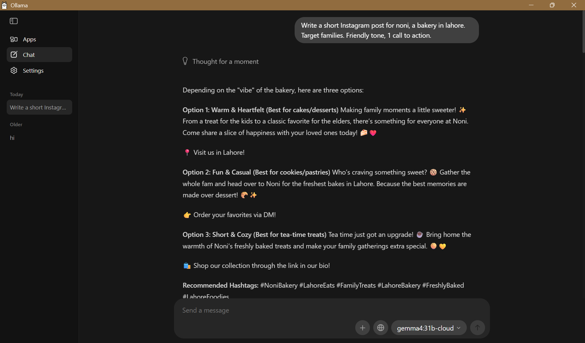
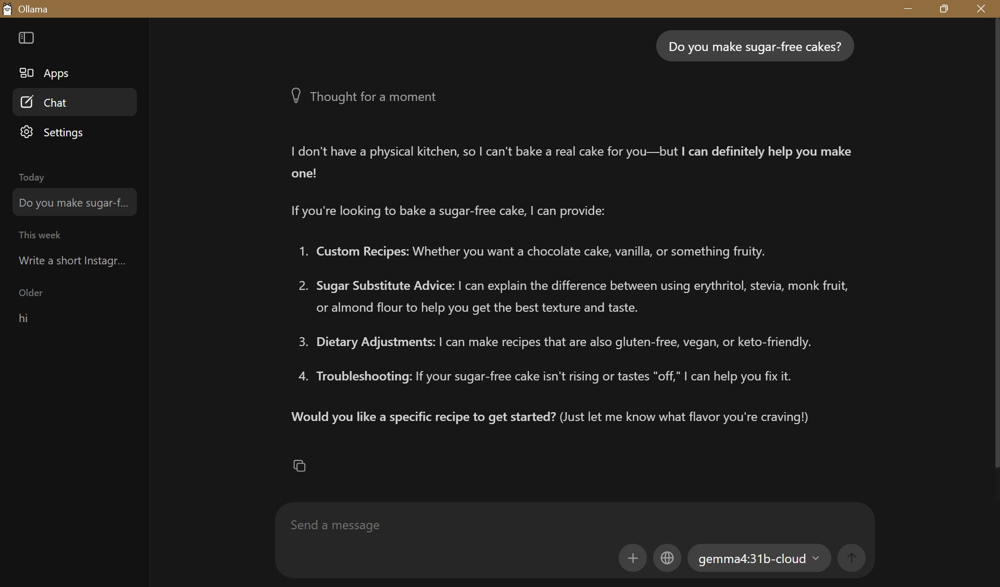

# Python for AI

**Name:** Ahmad  Sajjad
**Course:** (AI for everyone)

**AI goal:** I want to become an AI Automation Specialist who helps local businesses save time.

## How to run

    uv run main.py

## Lessons done so far

- Lesson 1: AI Career Intro (`code/lesson_01_intro.py`)
- Lesson 2: Toolkit Proof (`code/lesson_02_toolkit.py`)
- Lesson 4: Business Prompt Builder (`code/lesson_04_print_input.py`)

## Module 1 Project: AI Prompt Kit
 
A Python tool that turns a local business's details into 3 ready-to-use AI prompts.
 
**Run:** `uv run code/project_m1_prompt_kit.py`
 

 
**Who would pay for this:** Small shop owners who want AI help but don't know what to type.

## Task 1.8: Business Helper Bot (City Care Clinic)

A rule-based chatbot that answers common questions, hands complaints to a human, and counts what it could not answer.

**Run:** `uv run code/lesson_08_mini_chatbot.py`

### Design table

| # | Intent | What the user wants | Keywords to look for | Reply |
|---|--------|---------------------|----------------------|-------|
| 1 | Complaint / handover (checked first) | Report a problem or talk to a person | complaint, late, refund, rude, human, agent | "Sorry about that. The clinic manager will call you today." (human/agent: "Connecting you to a human...") |
| 2 | Greeting | Say hello | hi, hello, hey (exact match / startswith) | "Hello <name>! How can I help?" |
| 3 | Timings | Opening hours | timing, open, hours | "We are open 10 am to 8 pm, Monday to Saturday." |
| 4 | Fees | Price of a visit | fee, price, cost | "Consultation fee is 2,000 PKR." |
| 5 | Location | Where the clinic is | where, location, address | "We are on Main Road, near the city park." |
| 6 | Appointment | Book a visit | appointment, book | "Call us or visit during opening hours to book an appointment." |
| 7 | Exit | End the chat | bye | "Take care, <name>!" |
| 8 | Fallback | Anything else | (no match) | Counts as unanswered and prints the AI prompt for Module 2 |

## Module 1 Checkpoint 2 Project: AI Front Desk

A Python front desk for a local business that answers common questions with free rules, gives exact price quotes, and turns everything else into a cost-checked AI prompt.

**Run:** `uv run code/project_m1_front_desk.py`

**Value:** ("Saves the owner about 1 hour of staff time per day answering hours and price questions, and only spends AI money on the questions rules cannot answer.")